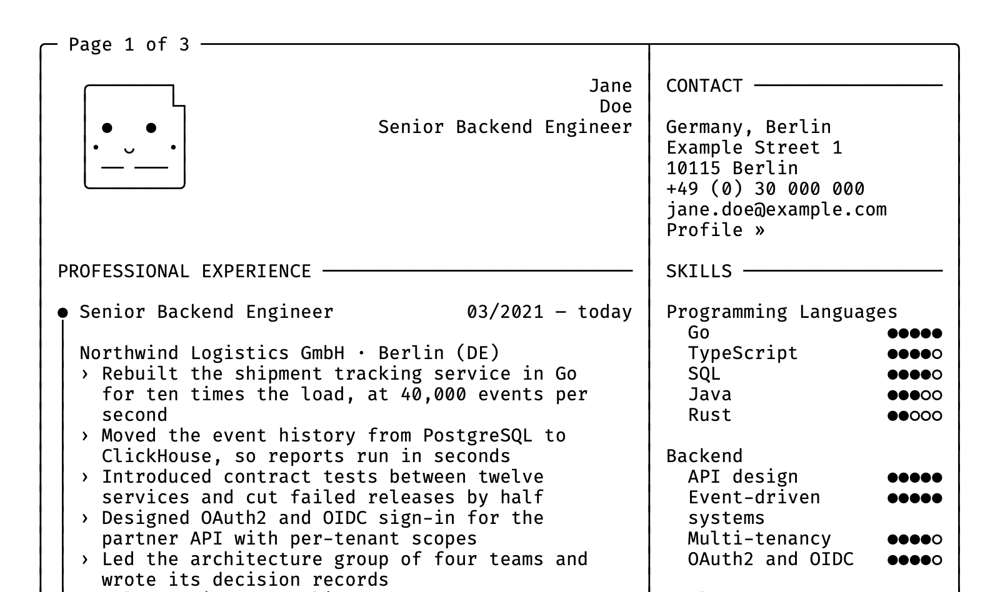

<div align="center">

<picture>
  <source media="(prefers-color-scheme: dark)" srcset="brand/header-dark.svg">
  
</picture>

**One CV, made to fit every job posting, laid out so no job ever breaks across a page.**


</div>

---

## 📄 What is oriko?

oriko makes a fitting version of your CV for every job you apply to. You write your CV once,
with your jobs, skills, languages and contact details. When you find a job you like, you give the
posting to an AI assistant, in plain words and in any language. The assistant fits your CV to
it: it moves the matching skills up, hides what does not help and shortens long lists, and it
never invents anything. You see the result right away as a preview of every page in the
terminal, and you get a Word file that you open in Google Docs and save as PDF, or the PDF itself
when LibreOffice is installed.

### Why oriko?

- 🤖 **Built for AI assistants**: oriko is a command-line tool an AI agent can drive on its own,
  from the first look at your CV to the finished file.
- 🧱 **Clean pages**: a job never breaks across two pages. If it does not fit, it moves to the next
  page as a whole.
- 🎯 **One CV, many versions**: each job posting gets a small version file. Add a new job to your
  CV once, and every version has it.
- ✅ **Honest by design**: a version only hides, reorders and shortens what you wrote. New claims
  need your yes.
- 👀 **Preview before you build**: see every page in the terminal, and how full it is.
- 🌍 **Several CVs**: one per language or per person, side by side.
- 🛡️ **Safe dependencies**: our own [supply check](https://github.com/honeyglass/actions/tree/main/supply-check)
  runs first in every CI run. A package comes in only from an allow list, a new version only once
  it is three days old, and no package may run programs while it installs. More in
  [SECURITY.md](SECURITY.md).

## 🚀 Quickstart

```bash
curl -fsSL https://raw.githubusercontent.com/honeyglass/oriko/main/install.sh | sh
```

The script installs the command `oriko` and then the agent skill, for Claude Code and every other
agent it finds. For the skill it runs the [skills CLI](https://www.skills.sh/) behind skills.sh.
Run the line again to update both.

<details>
<summary><b>With the PDF, without Google Docs</b></summary>

```bash
curl -fsSL https://raw.githubusercontent.com/honeyglass/oriko/main/install.sh | sh -s -- --pdf
```

oriko always writes the Word file for Google Docs. With [LibreOffice](https://www.libreoffice.org)
it writes the PDF too, the page Google Docs would make: `oriko build --out cv.pdf`. `--pdf`
installs LibreOffice with brew, apt or dnf; without it, the script names the command to run.

</details>

<details>
<summary><b>Command and skill separately</b></summary>

```bash
curl -fsSL https://raw.githubusercontent.com/honeyglass/oriko/main/install.sh | sh -s -- --no-skill
npx skills add honeyglass/oriko -g -y
```

</details>

<details>
<summary><b>Manual installation</b></summary>

```sh
git clone https://github.com/honeyglass/oriko.git
cd oriko
pnpm install --frozen-lockfile
node bin/oriko.ts schema
```

</details>

## ⭐ The recommended way

Give the agent three things at once, then answer its questions:

- **Your old CV**: a PDF, a Word file, or your oriko CV.
- **Notes in your own words**: what you did, how you work, what the old CV leaves out. Short
  lines are enough, in any language.
- **The job posting**: a file or a link.

```text
Create a CV for this job. My CV: ~/cv.pdf. My notes: ~/notes.txt. The posting: ~/job.pdf
```

The agent reads all three, asks in short rounds before a fact from your notes goes into your CV,
and builds a version for the posting. You read the preview and say what to change in plain
words ("shorter", "leave out Figma", "Built instead of Delivered"); the agent changes it and
shows the preview again. At the end you get the Word file, or the PDF.

This works well because each part does one job: your notes bring the facts the old CV misses,
the posting says what matters, and oriko checks every step, so nothing is invented.

Shorter requests work too:

```text
Fit my CV to this job: <paste the job posting>
Create a new CV for me. Since 03/2021 I have worked as a data engineer at …
```

**What the agent does for a job posting:**

- Picks your CV in the language of the posting.
- Reads the parts of your CV that matter for this job.
- Writes a version: matching skills first, unrelated old jobs hidden, long lists shortened.
- Checks that every block fits on the pages, and fixes it if not.
- Builds the Word file and shows you the preview, every change, and why it made it.
- Tells you what the posting asks for that your CV does not show yet.

No CV yet? See [Good to know](docs/good-to-know.md#-no-cv-yet).

## 🧩 Agentic meets deterministic

An agent alone can be wrong without noticing, and a tool alone cannot read a job posting. oriko
puts the two together: the agent does what needs judgment, and every step it takes runs through
a CLI that checks it, refuses what does not fit and never guesses.

oriko has two parts. The **CLI** does the work and checks every input. The **skill** in
[`.claude/skills/oriko/`](.claude/skills/oriko/SKILL.md) is the agent's manual: which command to
run when, what it may change, and when it stops and asks you.

### The skill: a fixed flow

The skill is a fixed list of steps, and for each step the steps that may follow (a state machine).
It has two paths. To fit a CV to a posting, the agent reads the posting, inspects
your CV, drafts a version, checks it, builds it and reports. To write a CV, it sorts your facts,
writes them, checks them and hands over; with no CV at all, it first asks you a few short
questions. The agent moves only along the listed steps. When oriko refuses a draft, the agent goes back
one step and fixes it, at most three times; then it stops and asks you. The steps, what each one
does and which may follow it, stand in [the flow of the skill](.claude/skills/oriko/SKILL.md#flow).

### The CLI: Agent DX rules

DX stands for developer experience: how easy a tool is to use. Agent DX asks the same question for
an AI agent, which cannot click through a menu or guess what a vague error means. The rules start
from Justin Poehnelt's article
[Rewrite your CLI for AI agents](https://justin.poehnelt.com/posts/rewrite-your-cli-for-ai-agents/)
(2026), with the [Google Workspace CLI](https://github.com/googleworkspace/cli) as its reference
implementation. [The CLI page](docs/cli.md) lists every rule oriko follows, its commands, and a
refusal as the agent reads it.

oriko navigates on its own: `oriko` alone shows where to start, every success names the next
commands, a refusal names the command that fixes it, and an option without a value lists the
values it accepts. A person needs no manual, and the agent acts on what oriko answers, never on a
guess.

<details>
<summary><b>Agent DX rules</b></summary>

The rules marked ➕ oriko are new: the author of oriko added them from building tools for agents.

| Rule | What oriko does | Why it helps the agent | Source |
| :--- | :--- | :--- | :--- |
| Raw JSON input | takes its whole input as one JSON object | passes the data as it is, without many flags | article |
| Schema at runtime | `oriko schema` shows every command and its input | looks the format up in the tool itself | article |
| JSON when piped | text for people, JSON for programs | each reader gets what it can read | article |
| Input hardening | the Word file and photos stay inside their folder | a mistake never writes elsewhere | article |
| Dry runs | `--dry-run` says what would happen | tries a command safely first | article |
| Agent skill | the agent's manual ships with the code | knows when to stop and ask you | article |
| Checks in layers | shape, then version, then pages; all errors at once | fixes real errors in one go | ➕ oriko |
| Errors with a hint | each error says where and what to change | fixes the input on its own | ➕ oriko |
| All or nothing | a refused command writes nothing | no file is left half changed | ➕ oriko |
| Exit codes 0, 1, 2 | 0 ok, 1 fix the input, 2 something broke | knows the next step from one number | ➕ oriko |
| Plan before the file | `plan` shows which block lands on which page | fixes an overflow before building | ➕ oriko |
| Hints that run | a refusal names the command that lists the fitting values | runs it and picks a real value | ➕ oriko |
| Options that list | an option without a value lists the values it accepts | finds names and ids in one call | ➕ oriko |
| Next steps | every success names its next commands and what each still needs | always knows where to go on | ➕ oriko |
| Nothing passes silently | an unknown command, option or word is refused, a group alone lists its actions | never acts on a typo | ➕ oriko |

</details>

## 🖥️ Terminal preview

**See your CV before the file exists.** `oriko preview` draws every page in the terminal, the left
column beside the right one, as in the finished document:

<picture>
  <source media="(prefers-color-scheme: dark)" srcset="examples/showcase/go-e-senior-backend/terminal-excerpt-dark.png">
  
</picture>

<details>
<summary><b>The same preview as text</b></summary>

```text
╭─ Page 1 of 3 ────────────────────────────────────────┬───────────────────────────╮
│                                                      │                           │
│   ╭───────┐                                     Jane │ CONTACT ───────────────── │
│   │       └┐                                     Doe │                           │
│   │ ●   ●  │                 Senior Backend Engineer │ Germany, Berlin           │
│   │•  ◡   •│                                         │ Example Street 1          │
│   │ ── ─── │                                         │ 10115 Berlin              │
│   ╰────────╯                                         │ +49 (0) 30 000 000        │
│                                                      │ jane.doe@example.com      │
│                                                      │ Profile »                 │
│                                                      │                           │
│ PROFESSIONAL EXPERIENCE ──────────────────────────── │ SKILLS ────────────────── │
│                                                      │                           │
│ ● Senior Backend Engineer            03/2021 – today │ Programming Languages     │
│ │                                                    │   Go                ●●●●● │
│ │ Northwind Logistics GmbH · Berlin (DE)             │   TypeScript        ●●●●○ │
│ │ › Rebuilt the shipment tracking service in Go      │   SQL               ●●●●○ │
│ │   for ten times the load, at 40,000 events per     │   Java              ●●●○○ │
│ │   second                                           │   Rust              ●●○○○ │
├──────────────────────────────────────────────────────┴───────────────────────────┤
│ Left  ■■■■■■■■□□ 84 % full     Right ■■■■■■■■■■ 97 % full                        │
╰──────────────────────────────────────────────────────────────────────────────────╯
```

</details>

```sh
oriko preview --profile go-e-senior-backend   # the version for one job posting
oriko preview --cv jane-doe                   # your CV as it stands
```

**Send the preview as a CV.** `build --style terminal` writes the sheets as a Word file, one A4
page each, set in Fira Code so Google Docs keeps every character in its column. Send the classic
file to managers and the terminal file to developers:

```sh
oriko build --profile go-e-senior-backend --style terminal --out go-e-terminal.docx
```

What each mark of the preview means: [the terminal preview page](docs/terminal-preview.md).

## 🗂️ Your data

Your CVs live outside the repository, in `~/.oriko`; `--home <folder>` points oriko at another one.

```text
~/.oriko/
  cvs/jane-doe.json           your CV: language, person, contact, pages, blocks
  cvs/jane-doe.png            its photo
  profiles/backend-job.json   one version per job posting, naming its CV in "cv"
```

## 🔌 Compatibility

- **Google Docs**: the layout is tuned to how Google Docs sets the file, with Open Sans and
  Calibri. Open the Word file there and save it as PDF.
- ⚠️ **Word and LibreOffice** set the same file with other line breaks, so a block that fits in
  Google Docs may spill over to the next page.
- **PDF without Google Docs**: `oriko build --out <name>.pdf` writes the PDF through
  [LibreOffice](https://www.libreoffice.org/download), which has to be installed: on macOS
  `brew install --cask libreoffice`, on Debian or Ubuntu `sudo apt install libreoffice`, on
  Windows `winget install TheDocumentFoundation.LibreOffice`. Without it, oriko refuses and names
  these commands. For the PDF, oriko writes a .docx adjusted to how LibreOffice sets it and hands
  over the font files Google Docs uses ([assets/fonts](assets/fonts/README.md)), so the PDF shows
  the page Google Docs shows: the same lines, page breaks and positions, within about 1 pt. Only
  Calibri differs: it is not free, so the name and the headings use a font with its widths and
  its baseline, whose letters look a little different. The terminal style matches exactly. macOS
  and Linux; Windows is not covered yet.
- **Terminal style**: set in Fira Code, which Google Docs offers, so every character keeps its
  column.
- **Terminal preview**: every line is 84 characters wide; a narrower terminal breaks the lines.
- **Node**: 24 or newer, which runs the TypeScript files of oriko as they are.
- **Install script**: macOS and Linux. Windows is not tested; use the manual installation there.
- **Agents**: the skill is written and tested for Claude Code. The quickstart adds it to every
  agent the skills CLI finds; any agent that can run a command can use the CLI through
  `oriko schema`.

## 📖 Docs

- [**Examples**](docs/examples.md)
- [**By hand**](docs/by-hand.md)
- [**Sample data**](docs/sample-data.md)
- [**CLI**](docs/cli.md)
- [**Terminal preview**](docs/terminal-preview.md)
- [**Good to know**](docs/good-to-know.md)
- [**Security**](SECURITY.md)
- [**Agent skill**](.claude/skills/oriko/SKILL.md)

## 🗺️ Roadmap

- [ ] More CV templates
- [ ] An [ATS check](https://enhancv.com/resources/resume-checker/) of the classic CV after every build
- [ ] The skill for Codex
- [ ] The skill for Gemini CLI
- [ ] A cover letter per job posting, from the same facts as the CV
- [ ] A one-line installer for Windows
- [ ] A new CV from a LinkedIn export or a JSON Resume file
- [ ] The PDF from Google Docs without uploading the file by hand
- [ ] Publish on npm as `oriko`

## 🛠️ Development

```sh
pnpm test             # api and internals tests, fails below 95 % coverage
pnpm run typecheck
pnpm run format:check
sh tests/e2e/install.e2e.sh   # the install script in empty home folders
pnpm baselines:update         # new Google PDFs and page images for changed showcase files (macOS)
pnpm baselines:gws auth login # signs gws in once, for baselines:update
```

## ⚖️ License

Copyright (C) 2026 Serkan Sipahi. oriko is free software under the
[GNU Affero General Public License v3.0](LICENSE): you may use, change and share it. Anyone who
shares a changed version, or offers one as a service over a network, must publish its source
under the same license.

The name oriko and the Oriko character are not covered by this license. That includes the
files in [`brand/`](brand/) and the Oriko drawing the preview shows; all rights to them stay
with the author. A changed version of oriko needs another name and logo.
