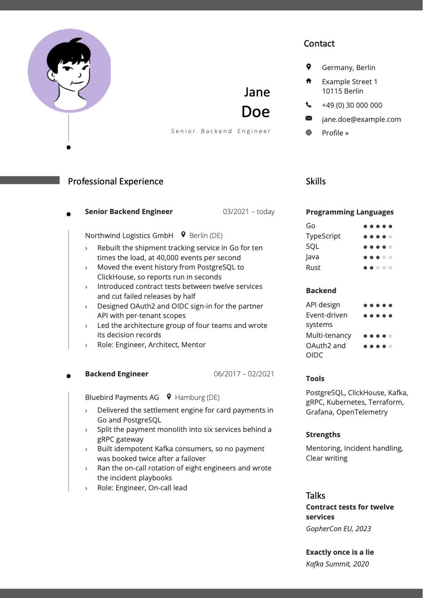
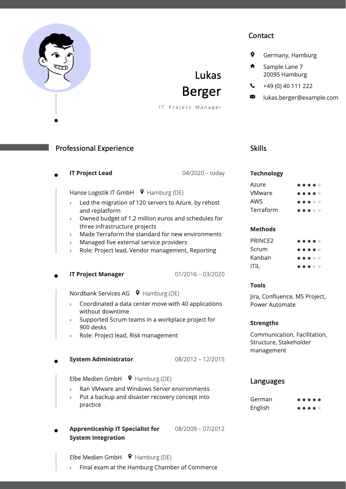

<div align="center">

<h1>◈ &nbsp; C V F I T &nbsp; ◈</h1>

**One CV, tailored to every job posting, laid out so no job ever breaks across a page.**


</div>

---

## What is oriko?

oriko makes a fitting version of your CV for every job you apply to. You write your CV once,
with your jobs, skills, languages and contact details. When you find a job you like, you give the
posting to an AI assistant, in plain words and in any language. The assistant tailors your CV to
it: it moves the matching skills up, hides what does not help and shortens long lists, and it
never invents anything. You see the result right away as a preview of every page in the
terminal, and you get a Word file that you open in Google Docs and save as PDF.

> [!TIP]
> **See it in action:** three real job postings, tailored by the agent.
>
> | Example | Terminal preview | Result |
> | :--- | :--- | :--- |
> | Developer at go-e Labs | [preview](examples/showcase/go-e-senior-backend/preview.txt) | [PDF](examples/showcase/go-e-senior-backend/go-e-senior-backend.pdf) · [Word](examples/showcase/go-e-senior-backend/go-e-senior-backend.docx) |
> | Project manager at DaVita | [preview](examples/showcase/davita-it-project-manager/preview.txt) | [PDF](examples/showcase/davita-it-project-manager/davita-it-project-manager.pdf) · [Word](examples/showcase/davita-it-project-manager/davita-it-project-manager.docx) |
> | Cook at GALERIA Restaurant | [preview](examples/showcase/galeria-cook/preview.txt) | [PDF](examples/showcase/galeria-cook/galeria-cook.pdf) · [Word](examples/showcase/galeria-cook/galeria-cook.docx) |
>
> More in [Examples](#examples).

### Why oriko?

- 🤖 **Built for AI assistants**: oriko is a command-line tool an AI agent can drive on its own,
  from the first look at your CV to the finished file.
- 🧱 **Clean pages**: a job never breaks across two pages. If it does not fit, it moves to the next
  page as a whole.
- 🎯 **One CV, many versions**: each job posting gets a small version file. Add a new job to your
  CV once, and every version has it.
- ✅ **Honest by design**: a version only hides, reorders and shortens what you wrote. New claims
  need your yes.
- 👀 **Preview before you build**: see every page in the terminal, and how full it is.
- 🌍 **Several CVs**: one per language or per person, side by side.
- 🛡️ **Safe dependencies**: new package versions wait three days, no install scripts run, every
  version is pinned.

### oriko vs editing a document by hand

| Task | Word or Google Docs by hand | **oriko** |
| :--- | :--- | :--- |
| **Add a job** | ⚠️ move text boxes and lines yourself | ✅ one command; everything below moves down |
| **A version per job posting** | ❌ copy the document, edit every copy | ✅ a small file with the changes |
| **Change all versions** | ❌ in every copy | ✅ once, in your CV |
| **Page breaks** | ⚠️ checked by eye, after the edit | ✅ planned before the file exists |
| **Work with an AI assistant** | ❌ copy and paste | ✅ the assistant runs oriko itself |
| **Stay truthful** | ⚠️ up to you | ✅ nothing is added that you did not say |

## Installation

oriko needs Node 24 or newer and pnpm.

```sh
git clone git@github.com:honeyglass/oriko.git
cd oriko
pnpm install --frozen-lockfile
node bin/oriko.ts schema
```

> [!NOTE]
> There is no build step: Node runs the TypeScript sources directly. The examples below write
> `oriko` for `node bin/oriko.ts`.

## Working with an agent

Open [Claude Code](https://claude.com/claude-code) in this folder and say what you want. The skill
in [`.claude/skills/oriko/`](.claude/skills/oriko/SKILL.md) tells the agent how to use oriko.

```text
Tailor my CV to this job: <paste the job posting>
Create a new CV for me. Since 03/2021 I have worked as a data engineer at …
```

> [!TIP]
> You can write to the agent in any language. It keeps your CV in the CV's own language.

**What the agent does for a job posting:**

1. Picks your CV in the language of the posting.
2. Reads the parts of your CV that matter for this job.
3. Writes a version: matching skills first, unrelated old jobs hidden, long lists shortened.
4. Checks that every block fits on the pages, and fixes it if not.
5. Builds the Word file and shows you the preview, every change, and why it made it.
6. Tells you what the posting asks for that your CV does not show yet.

> [!TIP]
> No CV yet? Paste a job posting anyway. The agent asks you a few short questions (your name,
> where you live, where you have worked, what you can do), creates your CV from your answers, and
> then tailors it to the posting.

> [!IMPORTANT]
> The agent never adds a skill, a level, a date or a fact you did not state. It never changes your
> CV for a single job, and never overwrites a version you already have. When it needs any of that,
> it stops and asks you.

> [!WARNING]
> An agent can still misread or reword a fact. Before you send a CV, read the terminal preview
> and the PDF line by line: names, employers, places, dates and levels.

<details>
<summary><b>🔬 For developers: what makes oriko agent-driven</b></summary>

| Property | What the agent gets |
| :--- | :--- |
| JSON in, JSON out | each command takes its input as `--json` or stdin and answers one JSON object |
| Self-describing | `oriko schema` lists the commands, `oriko schema <command>` the exact input |
| Refusals that say what to do | exit 1 with an issue code, the path of the wrong value and a hint |
| Nothing half-written | a refused command writes nothing, and every write goes through the same checks |
| Dry runs | `--dry-run` answers what would happen and writes no file |
| Page plan before the file | `plan` says which block lands on which page, so the agent fixes an overflow first |
| A fixed flow | the skill is a state machine with bounded retries; it stops and asks after three |

A refusal the agent reads and acts on:

```json
{
  "ok": false,
  "kind": "fix",
  "issues": [
    {
      "code": "PAGE_OVERFLOW",
      "path": "pages",
      "message": "These blocks of the left column land after page 1: campus",
      "hint": "Hide or shorten blocks of the left column, remove a page pin, or raise \"pages\""
    }
  ]
}
```

</details>

## Terminal preview

**See your CV before the file exists.** `oriko preview` draws every page in the terminal, the left
column beside the right one, as in the finished document:

```text
╭─ Page 1 of 3 ────────────────────────────────────────┬───────────────────────────╮
│    ╭───────╮                                    Jane │ CONTACT                   │
│    │  ◠ ◠  │                                     Doe │ Germany, Berlin           │
│    │   ‿   │                 Senior Backend Engineer │ Example Street 1          │
│    ╰───────╯                                         │ 10115 Berlin              │
│                                                      │ +49 (0) 30 000 000        │
│ PROFESSIONAL EXPERIENCE                              │ jane.doe@example.com      │
│                                                      │ Profile »                 │
│ 03/2021 – today   ● Senior Backend Engineer          │                           │
│                   │ Northwind Logistics GmbH ·       │ SKILLS                    │
│                   │   Berlin (DE)                    │ Programming Languages     │
│                   │ ✓ Rebuilt the shipment           │ Go                  ●●●●● │
│                   │   tracking service in Go for ten │ TypeScript          ●●●●○ │
│                   │   times the load, at 40,000      │ SQL                 ●●●●○ │
│                   │   events per second              │ Java                ●●●○○ │
├──────────────────────────────────────────────────────┴───────────────────────────┤
│ Left  ▰▰▰▰▰▰▰▰▱▱ 80 % full     Right ▰▰▰▰▰▰▰▰▰▰ 98 % full                        │
╰──────────────────────────────────────────────────────────────────────────────────╯
```

```sh
oriko preview --profile go-e-senior-backend   # the version for one job posting
oriko preview --cv jane-doe                   # your CV as it stands
```

| Mark | Meaning |
| :--- | :--- |
| `╭───────╮` with `◠ ◠` | where your photo goes; the terminal shows a face, the file shows the photo |
| `UPPER CASE` | a section heading, such as Professional Experience |
| `●` and `│` | a job: its dates, its marker and its timeline |
| `✓` | a bullet point of a job |
| `●●●●○` | a skill level, from 0 to 5 dots |
| `▰▰▰▱▱` | how full the column is; at 100 % the next block moves to the next page |

When your CV needs more pages than allowed, the preview names the blocks that do not fit and says
what to change:

```text
Refused (fix) at place: the input has 2 issue(s).
Next: fix every listed issue and call again.
Nothing was written.
- PAGE_OVERFLOW at pages: "These blocks of the left column land after page 1: campus". Hide or shorten blocks of the left column, remove a page pin, or raise "pages".
```

> [!TIP]
> A page that looks too empty usually has a block pinned to the next page in your CV
> (`"page": 2`). A version can clear the pin with `"page": null`.

In a pipe, `preview` answers JSON with the sheets in the field `preview`; `--output text` prints
the sheets there too.

> [!WARNING]
> The preview shows what stands on which page, in which order, and how full each column is. It
> does not show fonts, exact distances or the photo. The page plan behind it is the one `build`
> uses.

## Examples

Three made-up people, three real job postings, one agent run each. Every example holds the
summary of the posting, the agent's report, the terminal preview, the Word file and the PDF that
Google Docs made from it.

| | Developer | Project manager | Cook |
| :--- | :--- | :--- | :--- |
| **Person** | Jane Doe, Berlin | Lukas Berger, Hamburg | Marco Weber, Munich |
| **Pages** | 3, the right column on 2 | 2, the right column on 2 | 1 |
| **Job posting** | [Senior Backend Engineer at go-e Labs](examples/showcase/go-e-senior-backend/posting.md) | [IT Project Manager at DaVita](examples/showcase/davita-it-project-manager/posting.md) | [Cook at GALERIA Restaurant](examples/showcase/galeria-cook/posting.md) |
| **What the agent did** | [report](examples/showcase/go-e-senior-backend/report.md) | [report](examples/showcase/davita-it-project-manager/report.md) | [report](examples/showcase/galeria-cook/report.md) |
| **Result** | [preview](examples/showcase/go-e-senior-backend/preview.txt) · [Word](examples/showcase/go-e-senior-backend/go-e-senior-backend.docx) · [PDF](examples/showcase/go-e-senior-backend/go-e-senior-backend.pdf) | [preview](examples/showcase/davita-it-project-manager/preview.txt) · [Word](examples/showcase/davita-it-project-manager/davita-it-project-manager.docx) · [PDF](examples/showcase/davita-it-project-manager/davita-it-project-manager.pdf) | [preview](examples/showcase/galeria-cook/preview.txt) · [Word](examples/showcase/galeria-cook/galeria-cook.docx) · [PDF](examples/showcase/galeria-cook/galeria-cook.pdf) |

<p align="center">
  
  
  
</p>

<p align="center">
  
  
</p>

<p align="center">
  
</p>

> [!NOTE]
> The people are invented. The postings are real, summarized in our own words with a link to the
> source, and may be gone by now. The portraits are drawn avatars from
> [DiceBear](https://www.dicebear.com/styles/lorelei/) (Lorelei, CC0 1.0).

## Your data

Your CVs live outside the repository, in `~/.oriko`; `--home <folder>` points oriko at another one.

```text
~/.oriko/
  cvs/jane-doe.json        your CV: language, person, contact, pages, blocks
  cvs/jane-doe.png         its photo
  profiles/acme.json       one version per job posting, naming its CV in "cv"
```

> [!NOTE]
> Your CVs never go into the repository. They stay in `~/.oriko` on your computer. An AI
> assistant you work with reads the parts of them it needs, as with any file you show it.

> [!TIP]
> Try oriko without your own data: [`examples/`](examples/) holds a complete data folder. Add
> `--home examples` to any command.

## Commands

Every command answers one JSON object, exit 0 for success and 1 for a refusal with its issues and a
hint each. `oriko schema` lists every command and option, `oriko schema <command>` the input one
accepts.

| Command | What it does |
| :--- | :--- |
| `cvs`, `profiles` | list your CVs and versions, and whether each one fits its pages |
| `show` | outline of a CV; `--block <id>` shows one block in full |
| `plan`, `preview` | the page plan as JSON, or as the sheets above |
| `build --out <file>.docx` | writes the Word file; `--dry-run` writes nothing |
| `init`, `cv update` | create a CV, change its language, pages, person or contact title |
| `block …`, `item …`, `contact …` | add, update, remove and move blocks, their items and contact lines |
| `photo set <file>` | stores a PNG or JPEG as the square photo of a CV, or of one version |

## First steps by hand

The agent runs these commands for you. By hand, they look like this.

Create a CV and fill it:

```sh
oriko init --cv jane-doe --json '{"language":"en","firstName":"Jane","lastName":"Doe","role":"Backend Engineer"}'
oriko contact add --json '{"value":{"icon":"mail","lines":["jane.doe@example.com"]}}'
oriko block add --json '{"block":{"id":"northwind","kind":"job","section":"Professional Experience","from":"03/2021","to":"today","title":"Backend Engineer","place":"Berlin (DE)","employer":"Northwind GmbH","bullets":["Rebuilt the tracking service"]}}'
oriko block add --json '{"block":{"id":"tools","kind":"list","section":"Skills","title":"Tools","items":["Go","Kafka","Terraform"]}}'
oriko photo set ~/Pictures/portrait.jpg
```

Write a version for one job posting in `~/.oriko/profiles/acme.json`:

```json
{ "cv": "jane-doe", "blocks": { "tools": { "items": ["Go", "Kafka"] } } }
```

Check, look, build:

```sh
oriko plan --profile acme
oriko preview --profile acme
oriko build --profile acme --out acme.docx
```

Upload `acme.docx` to Google Docs and save it there with File, Download, PDF.

> [!WARNING]
> The layout is tuned to how Google Docs sets the file, with Open Sans and Calibri. Word or
> LibreOffice set the same file with other line breaks, and a block that fits in Google Docs may
> spill over elsewhere.

## Development

```sh
pnpm test             # api and internals tests
pnpm run typecheck
pnpm run format:check
```

## License

GNU Affero General Public License v3.0, see [LICENSE](LICENSE).
