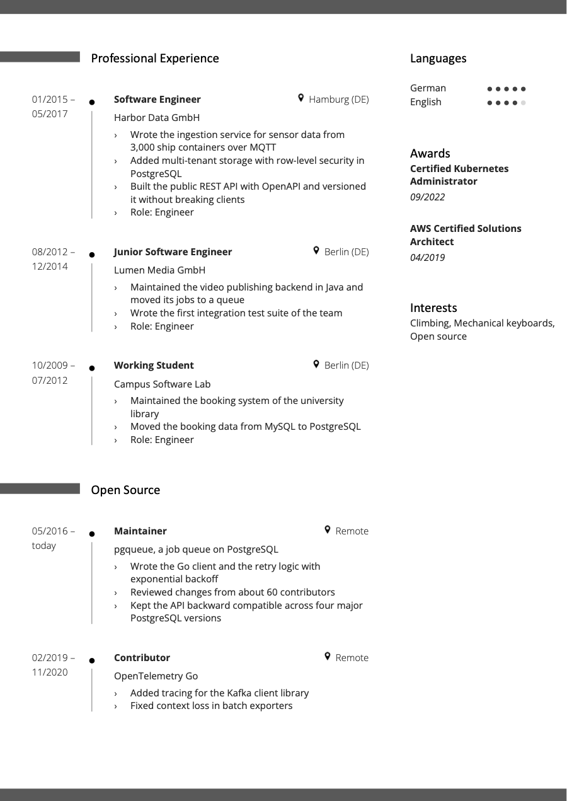
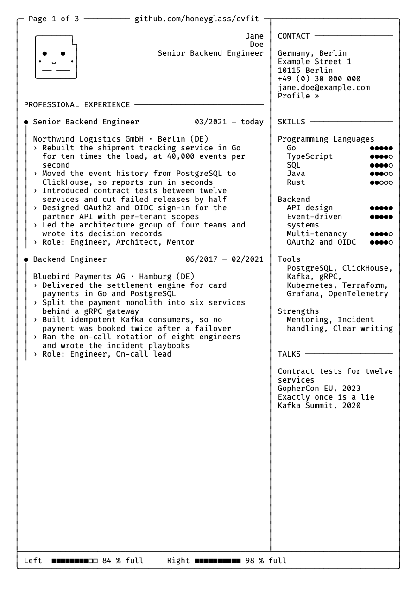
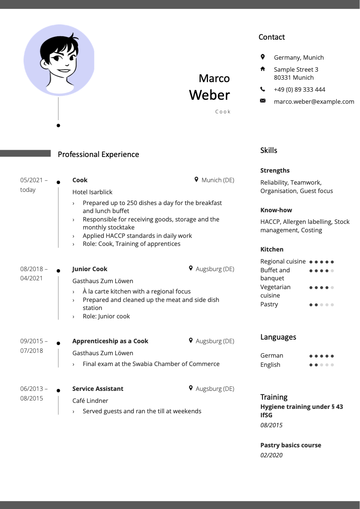
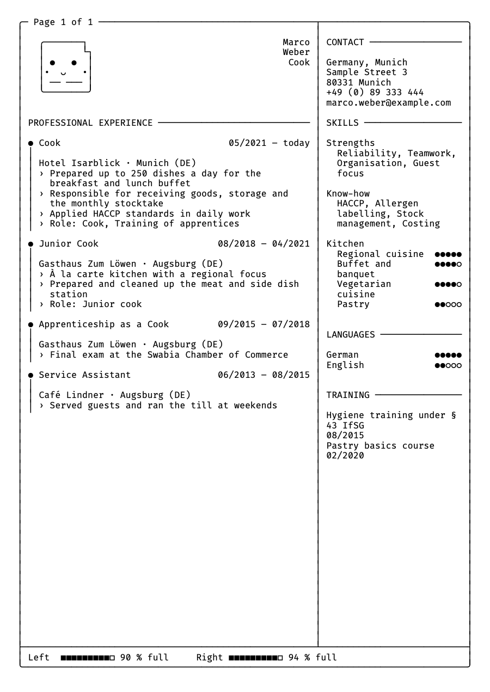

<div align="center">

<picture>
  <source media="(prefers-color-scheme: dark)" srcset="brand/header-dark.svg">
  
</picture>

**One CV, made to fit every job posting, laid out so no job ever breaks across a page.**


</div>

---

## 📄 What is oriko?

oriko makes a fitting version of your CV for every job you apply to. You write your CV once,
with your jobs, skills, languages and contact details. When you find a job you like, you give the
posting to an AI assistant, in plain words and in any language. The assistant fits your CV to
it: it moves the matching skills up, hides what does not help and shortens long lists, and it
never invents anything. You see the result right away as a preview of every page in the
terminal, and you get a Word file that you open in Google Docs and save as PDF.

### Why oriko?

- 🤖 **Built for AI assistants**: oriko is a command-line tool an AI agent can drive on its own,
  from the first look at your CV to the finished file.
- 🧱 **Clean pages**: a job never breaks across two pages. If it does not fit, it moves to the next
  page as a whole.
- 🎯 **One CV, many versions**: each job posting gets a small version file. Add a new job to your
  CV once, and every version has it.
- ✅ **Honest by design**: a version only hides, reorders and shortens what you wrote. New claims
  need your yes.
- 👀 **Preview before you build**: see every page in the terminal, and how full it is.
- 🌍 **Several CVs**: one per language or per person, side by side.
- 🛡️ **Safe dependencies**: oriko takes in a new version of a package (code from other people)
  only once it is three days old, so a bad release is usually caught first. Packages may not run
  their own programs while they install, and every version is fixed, so every install gets the
  same code.

### oriko vs editing a document by hand

| Task | Word or Google Docs by hand | **oriko** |
| :--- | :--- | :--- |
| **Add a job** | ⚠️ move text boxes and lines yourself | ✅ one command; everything below moves down |
| **A version per job posting** | ❌ copy the document, edit every copy | ✅ a small file with the changes |
| **Change all versions** | ❌ in every copy | ✅ once, in your CV |
| **Page breaks** | ⚠️ checked by eye, after the edit | ✅ planned before the file exists |
| **Work with an AI assistant** | ❌ copy and paste | ✅ the assistant runs oriko itself |
| **Stay truthful** | ⚠️ up to you | ✅ nothing is added that you did not say |

## 📦 Installation

oriko needs Node 24 or newer and pnpm.

```sh
git clone git@github.com:honeyglass/oriko.git
cd oriko
pnpm install --frozen-lockfile
node bin/oriko.ts schema
```

> [!NOTE]
> You do not compile anything first: Node 24 runs the TypeScript files of oriko as they are. The
> examples below write `oriko` for `node bin/oriko.ts`.

## 🤖 Working with an agent

Open [Claude Code](https://claude.com/claude-code) in this folder and say what you want. The skill
in [`.claude/skills/oriko/`](.claude/skills/oriko/SKILL.md) tells the agent how to use oriko.

```text
Fit my CV to this job: <paste the job posting>
Create a new CV for me. Since 03/2021 I have worked as a data engineer at …
```

**What the agent does for a job posting:**

1. Picks your CV in the language of the posting.
2. Reads the parts of your CV that matter for this job.
3. Writes a version: matching skills first, unrelated old jobs hidden, long lists shortened.
4. Checks that every block fits on the pages, and fixes it if not.
5. Builds the Word file and shows you the preview, every change, and why it made it.
6. Tells you what the posting asks for that your CV does not show yet.

No CV yet? Paste a job posting anyway. The agent asks you a few short questions (your name, where
you live, where you have worked, what you can do), creates your CV from your answers, and then
fits it to the posting.

## 🧩 Built for agents

oriko has two parts. The **CLI** does the work and checks every input. The **skill** in
[`.claude/skills/oriko/`](.claude/skills/oriko/SKILL.md) is the agent's manual: which command to
run when, what it may change, and when it stops and asks you.

### The skill: a fixed flow

The skill is a fixed list of steps, and for each step the steps that may follow (a state machine).
It has two paths. To fit a CV to a posting, the agent reads the posting, inspects
your CV, drafts a version, checks it, builds it and reports. To write a CV, it sorts your facts,
writes them, checks them and hands over; with no CV at all, it first asks you a few short
questions. The agent moves only along the listed steps. When oriko refuses a draft, the agent goes back
one step and fixes it, at most three times; then it stops and asks you.

### The CLI: Agent DX rules

DX stands for developer experience: how easy a tool is to use. Agent DX asks the same question for
an AI agent, which cannot click through a menu or guess what a vague error means. The rules start
from Justin Poehnelt's article
[Rewrite your CLI for AI agents](https://justin.poehnelt.com/posts/rewrite-your-cli-for-ai-agents/)
(2026), with the [Google Workspace CLI](https://github.com/googleworkspace/cli) as its reference
implementation. oriko adds its own rules on top.

| Rule | What oriko does | Why it helps the agent | From |
| :--- | :--- | :--- | :--- |
| Raw JSON input | Every command takes its whole input as one JSON object, after `--json` or on standard input (text another program sends in). | The agent passes the data as it is, without turning it into many separate flags. | article |
| Schema at runtime | `oriko schema` lists every command, and `oriko schema <command>` shows the exact input one accepts. | The agent looks the format up in the tool itself, so it never relies on an outdated manual. | article |
| JSON when piped | In a terminal, oriko prints text for people. When another program reads the output through a pipe, oriko prints one JSON object. `--output` picks one by hand. | People get text they can read, programs get data they can parse. | article |
| Input hardening | The path of the Word file and of every photo must stay inside its folder. | An agent can make a mistake, or follow a text it read. oriko then refuses instead of writing elsewhere on your computer. | article |
| Dry runs | `--dry-run` answers what a command would do, and writes nothing. | The agent can try a command safely before it runs it for real. | article |
| Agent skill | The agent's manual lies in the repository, next to the code. | The agent learns what no command can tell it, such as when to stop and ask you. | article |
| Checks in layers | oriko checks in order: the shape of the data, then the version file, then whether it fits on the pages. Each step lists all of its errors at once. | The agent sees only real errors, never follow-up errors of an earlier one, and fixes them in one go. | added |
| Errors with a hint | Each error names a code, where the wrong value is, and what to change. | The agent can fix the input on its own, without asking you what the error means. | added |
| All or nothing | A refused command writes nothing, and every write passes the same checks. | No file is ever left half changed. | added |
| Exit codes 0, 1, 2 | When it ends, oriko returns a number: 0 when all went well, 1 when the input needs a fix, 2 when something broke. | The agent knows what to do next from one number, without reading the text. | added |
| Plan before the file | `plan` says which block lands on which page before any file exists. | The agent fixes a page that runs over first, instead of building the file and looking at it. | added |

A refusal the agent reads and acts on:

```json
{
  "ok": false,
  "kind": "fix",
  "issues": [
    {
      "code": "PAGE_OVERFLOW",
      "path": "pages",
      "message": "These blocks of the left column land after page 1: campus",
      "hint": "Hide or shorten blocks of the left column, remove a page pin, or raise \"pages\""
    }
  ]
}
```

`"ok": false` means oriko refused. `"kind": "fix"` says the agent can fix the input itself. Each
issue has a `code` the agent can check, a `path` to the wrong value, a `message` for people and a
`hint` on what to change.

## 🖥️ Terminal preview

**See your CV before the file exists.** `oriko preview` draws every page in the terminal, the left
column beside the right one, as in the finished document:

```text
╭─ Page 1 of 3 ────────────────────────────────────────┬───────────────────────────╮
│    ╭─────────╮                                       │ CONTACT                   │
│    │         │                                  Jane │ Germany, Berlin           │
│    │  ◠   ◠  │                                   Doe │ Example Street 1          │
│    │    ◡    │               Senior Backend Engineer │ 10115 Berlin              │
│    │         │                                       │ +49 (0) 30 000 000        │
│    ╰─────────╯                                       │ jane.doe@example.com      │
│                                                      │ Profile »                 │
│ PROFESSIONAL EXPERIENCE                              │                           │
│                                                      │ SKILLS                    │
│ 03/2021 – today   ● Senior Backend Engineer          │ Programming Languages     │
│                   │ Northwind Logistics GmbH ·       │ Go                  ●●●●● │
│                   │   Berlin (DE)                    │ TypeScript          ●●●●○ │
│                   │ ✓ Rebuilt the shipment           │ SQL                 ●●●●○ │
│                   │   tracking service in Go for ten │ Java                ●●●○○ │
│                   │   times the load, at 40,000      │ Rust                ●●○○○ │
│                   │   events per second              │                           │
├──────────────────────────────────────────────────────┴───────────────────────────┤
│ Left  ■■■■■■■■□□ 80 % full     Right ■■■■■■■■■■ 98 % full                        │
╰──────────────────────────────────────────────────────────────────────────────────╯
```

```sh
oriko preview --profile go-e-senior-backend   # the version for one job posting
oriko preview --cv jane-doe                   # your CV as it stands
```

**Send the preview as a CV.** `build --style terminal` writes the sheets as a Word file, one A4
page each, set in Fira Code so Google Docs keeps every character in its column. Send the classic
file to managers and the terminal file to developers:

```sh
oriko build --profile go-e-senior-backend --style terminal --out go-e-terminal.docx
```

<details>
<summary><b>What the marks mean</b></summary>

| Mark | Meaning |
| :--- | :--- |
| `╭─────────╮` with `◠   ◠` | where your photo goes; the terminal shows a face, the file shows the photo |
| `UPPER CASE` | a section heading, such as Professional Experience |
| `●` and `│` | a job: its dates, its marker and its timeline |
| `✓` | a bullet point of a job |
| `●●●●○` | a skill level, from 0 to 5 dots |
| `■■■□□` | how full the column is; at 100 % the next block moves to the next page |

</details>

When your CV needs more pages than allowed, the preview names the blocks that do not fit and says
what to change:

```text
Refused (fix) at place: the input has 2 issue(s).
Next: fix every listed issue and call again.
Nothing was written.
- PAGE_OVERFLOW at pages: "These blocks of the left column land after page 1: campus". Hide or shorten blocks of the left column, remove a page pin, or raise "pages".
```

The first line says that oriko refused, that the input can be fixed (`fix`), and at which step
(`place`, the page planning). Each line that starts with `-` names one problem and what to change.

When another program reads the output instead of a terminal, `preview` answers JSON with the
sheets in its field `preview`. Add `--output text` to get the plain sheets there too.

## 📚 Examples

Three made-up people, three real job postings, one agent run each. Every example holds the
summary of the posting, the agent's report, the terminal preview, and the Word file and the PDF
that Google Docs made from it, in the classic and in the terminal style.

| | Developer | Project manager | Cook |
| :--- | :--- | :--- | :--- |
| **Person** | Jane Doe, Berlin | Lukas Berger, Hamburg | Marco Weber, Munich |
| **Pages** | 3, the right column on 2 | 2, the right column on 2 | 1 |
| **Job posting** | [Senior Backend Engineer at go-e Labs](examples/showcase/go-e-senior-backend/posting.md) | [IT Project Manager at DaVita](examples/showcase/davita-it-project-manager/posting.md) | [Cook at GALERIA Restaurant](examples/showcase/galeria-cook/posting.md) |
| **What the agent did** | [report](examples/showcase/go-e-senior-backend/report.md) | [report](examples/showcase/davita-it-project-manager/report.md) | [report](examples/showcase/galeria-cook/report.md) |
| **Result** | [preview](examples/showcase/go-e-senior-backend/preview.txt) · [Word](examples/showcase/go-e-senior-backend/go-e-senior-backend.docx) · [PDF](examples/showcase/go-e-senior-backend/go-e-senior-backend.pdf) | [preview](examples/showcase/davita-it-project-manager/preview.txt) · [Word](examples/showcase/davita-it-project-manager/davita-it-project-manager.docx) · [PDF](examples/showcase/davita-it-project-manager/davita-it-project-manager.pdf) | [preview](examples/showcase/galeria-cook/preview.txt) · [Word](examples/showcase/galeria-cook/galeria-cook.docx) · [PDF](examples/showcase/galeria-cook/galeria-cook.pdf) |
| **Terminal style** | [Word](examples/showcase/go-e-senior-backend/go-e-senior-backend-terminal.docx) · [PDF](examples/showcase/go-e-senior-backend/go-e-senior-backend-terminal.pdf) | [Word](examples/showcase/davita-it-project-manager/davita-it-project-manager-terminal.docx) · [PDF](examples/showcase/davita-it-project-manager/davita-it-project-manager-terminal.pdf) | [Word](examples/showcase/galeria-cook/galeria-cook-terminal.docx) · [PDF](examples/showcase/galeria-cook/galeria-cook-terminal.pdf) |

<details>
<summary><b>Jane Doe for go-e Labs, 3 pages</b></summary>

<p align="center">
  
  
  
</p>

</details>

<details>
<summary><b>Jane Doe for go-e Labs, 3 pages, terminal style</b></summary>

<p align="center">
  
  
  
</p>

</details>

<details>
<summary><b>Lukas Berger for DaVita, 2 pages</b></summary>

<p align="center">
  
  
</p>

</details>

<details>
<summary><b>Lukas Berger for DaVita, 2 pages, terminal style</b></summary>

<p align="center">
  
  
</p>

</details>

<details>
<summary><b>Marco Weber for GALERIA Restaurant, 1 page</b></summary>

<p align="center">
  
</p>

</details>

<details>
<summary><b>Marco Weber for GALERIA Restaurant, 1 page, terminal style</b></summary>

<p align="center">
  
</p>

</details>

> [!NOTE]
> The people are invented. The postings are real, summarized in our own words with a link to the
> source, and may be gone by now. The portraits are drawn avatars from
> [DiceBear](https://www.dicebear.com/styles/lorelei/) (Lorelei, CC0 1.0).

## 🗂️ Your data

Your CVs live outside the repository, in `~/.oriko`; `--home <folder>` points oriko at another one.

```text
~/.oriko/
  cvs/jane-doe.json        your CV: language, person, contact, pages, blocks
  cvs/jane-doe.png         its photo
  profiles/acme.json       one version per job posting, naming its CV in "cv"
```

> [!TIP]
> Try oriko without your own data: [`examples/`](examples/) holds a complete data folder. Add
> `--home examples` to any command.

## ⌨️ Commands

Every command answers one JSON object: on one line when another program reads it, indented in a
terminal, where `preview` shows its sheets and a refusal shows as readable lines. oriko ends with
exit code 0 when all went well, 1 when the input needs a fix (each issue with a hint), and 2 when
something broke. `oriko schema` lists every command and option, `oriko schema <command>` the input
one accepts.

| Command | What it does |
| :--- | :--- |
| `cvs`, `profiles` | list your CVs and versions, and whether each one fits its pages |
| `show` | outline of a CV; `--block <id>` shows one block in full |
| `plan`, `preview` | the page plan as JSON, or as the sheets above |
| `build --out <file>.docx` | writes the Word file; `--style terminal` in the look of the preview, `--dry-run` writes nothing |
| `init`, `cv update` | create a CV, change its language, pages, person or contact title |
| `block …`, `item …`, `contact …` | add, update, remove and move blocks, their items and contact lines |
| `photo set <file>` | stores a PNG or JPEG as the square photo of a CV, or of one version |

## ✍️ First steps by hand

The agent runs these commands for you. By hand, they look like this.

Create a CV and fill it:

```sh
oriko init --cv jane-doe --json '{"language":"en","firstName":"Jane","lastName":"Doe","role":"Backend Engineer"}'
oriko contact add --json '{"value":{"icon":"mail","lines":["jane.doe@example.com"]}}'
oriko block add --json '{"block":{"id":"northwind","kind":"job","section":"Professional Experience","from":"03/2021","to":"today","title":"Backend Engineer","place":"Berlin (DE)","employer":"Northwind GmbH","bullets":["Rebuilt the tracking service"]}}'
oriko block add --json '{"block":{"id":"tools","kind":"list","section":"Skills","title":"Tools","items":["Go","Kafka","Terraform"]}}'
oriko photo set ~/Pictures/portrait.jpg
```

Write a version for one job posting in `~/.oriko/profiles/acme.json`:

```json
{ "cv": "jane-doe", "blocks": { "tools": { "items": ["Go", "Kafka"] } } }
```

Check, look, build:

```sh
oriko plan --profile acme
oriko preview --profile acme
oriko build --profile acme --out acme.docx
```

Upload `acme.docx` to Google Docs and save it there with File, Download, PDF.

> [!WARNING]
> The layout is tuned to how Google Docs sets the file, with Open Sans and Calibri. Word or
> LibreOffice set the same file with other line breaks, and a block that fits in Google Docs may
> spill over elsewhere.

## 📌 Good to know

- ❗ **Important:** the agent never adds a skill, a level, a date or a fact you did not state. It
  never changes your CV for a single job, and never overwrites a version you already have. When
  it needs any of that, it stops and asks you.
- ⚠️ **Warning:** an agent can still misread or reword a fact. Before you send a CV, read the
  terminal preview and the PDF line by line: names, employers, places, dates and levels.
- ⚠️ **Warning:** the preview shows what stands on which page, in which order, and how full each
  column is. It does not show fonts, exact distances or the photo. The page plan behind it is the
  one `build` uses.
- ⚠️ **Warning:** send the terminal style by mail to people, not through an upload portal. A portal
  reads the text of the file, and the two columns of a sheet run together line by line.
- 💡 **Tip:** you can write to the agent in any language. It keeps your CV in the CV's own
  language.
- ℹ️ **Note:** your CVs never go into the repository. They stay in `~/.oriko` on your computer. An
  AI assistant you work with reads the parts of them it needs, as with any file you show it.
- 💡 **Tip:** a page that looks too empty usually has a block pinned to the next page in your CV:
  `"page": 2` on a block makes it start on page 2, however much room is left before it. A version
  can remove the pin with `"page": null`.

## 🛠️ Development

```sh
pnpm test             # api and internals tests
pnpm run typecheck
pnpm run format:check
```

## ⚖️ License

GNU Affero General Public License v3.0, see [LICENSE](LICENSE).
