# 📚 Examples

Three made-up people, three real job postings, one agent run each. Every example shows all pages,
first in the classic style for managers, then in the terminal style for developers.

| Example | Job | Pages |
| :--- | :--- | :---: |
| 👩‍💻 Jane Doe | Senior Backend Engineer at go-e Labs, Berlin | 3 |
| 📋 Lukas Berger | IT Project Manager at DaVita, Hamburg | 2 |
| 🍳 Marco Weber | Cook at GALERIA, Munich | 1 |

> [!NOTE]
> The people are invented. The postings are real, summarized in our own words with a link to the
> source, and may be gone by now. The portraits are drawn avatars from
> [DiceBear](https://www.dicebear.com/styles/lorelei/) (Lorelei, CC0 1.0).

## 👩‍💻 Jane Doe · go-e Labs

The agent hid nothing, as the whole career fits on three pages. It moved the ClickHouse work up
and the talks to page 1, as the posting asks for Go, ClickHouse and contract-first APIs.

| [Posting](../examples/showcase/go-e-senior-backend/posting.md) | [Agent's report](../examples/showcase/go-e-senior-backend/report.md) | [Preview](../examples/showcase/go-e-senior-backend/preview.txt) |
| :--- | :--- | :--- |
| **Classic** | [Word](../examples/showcase/go-e-senior-backend/go-e-senior-backend.docx) | [PDF](../examples/showcase/go-e-senior-backend/go-e-senior-backend.pdf) |
| **Terminal** | [Word](../examples/showcase/go-e-senior-backend/go-e-senior-backend-terminal.docx) | [PDF](../examples/showcase/go-e-senior-backend/go-e-senior-backend-terminal.pdf) |

  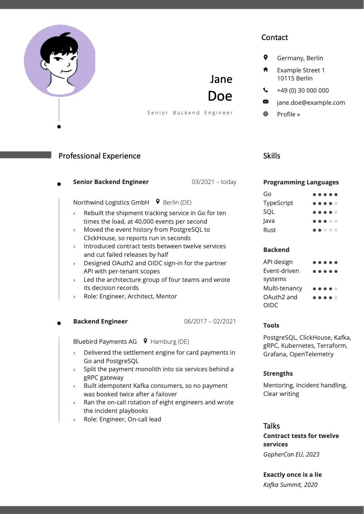
  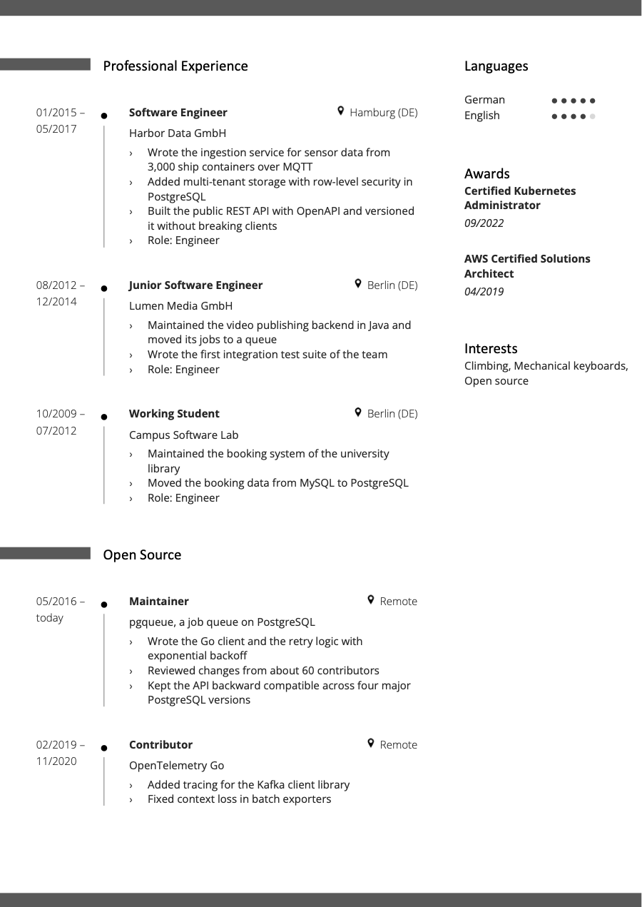
  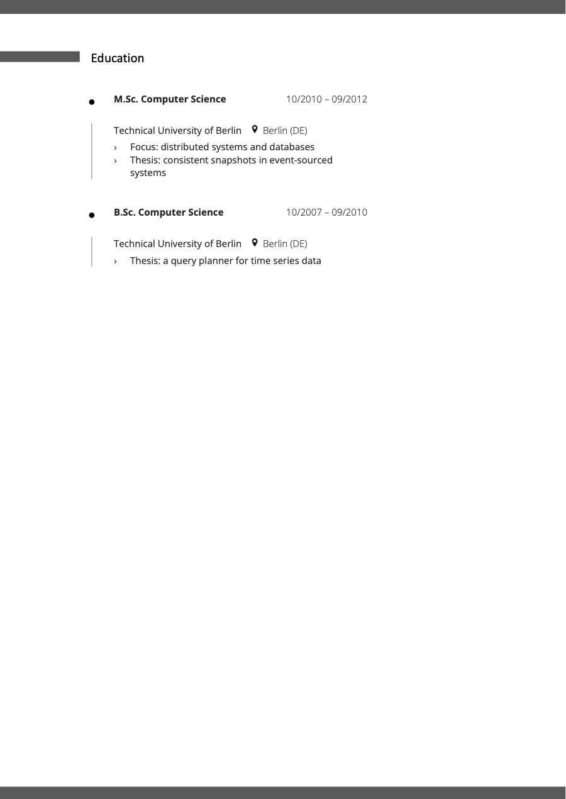

  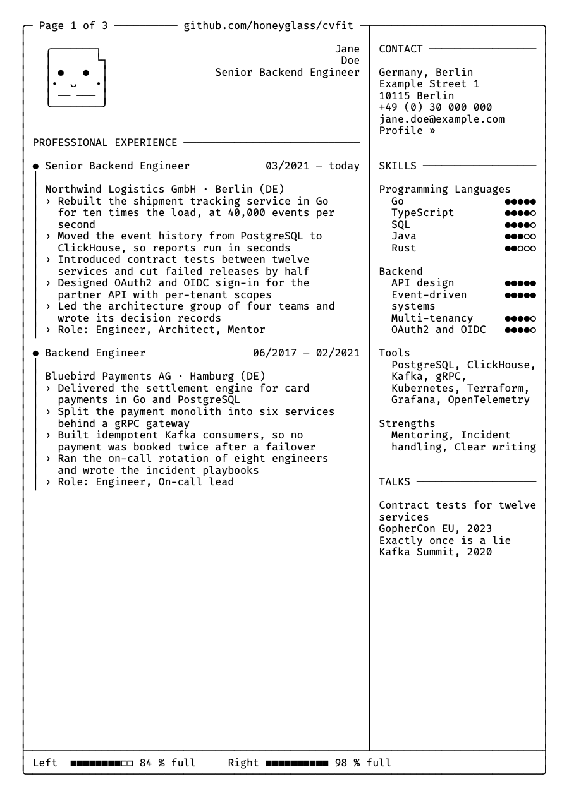
  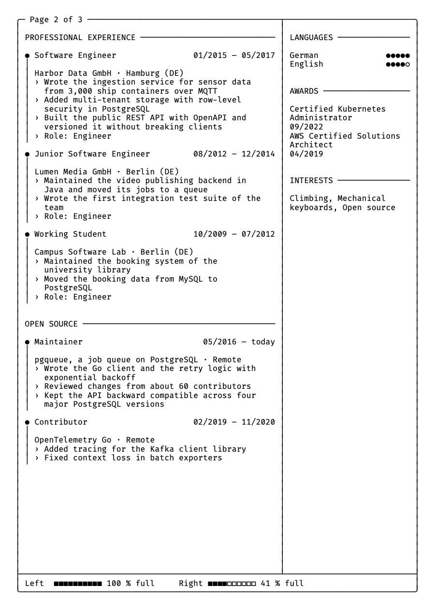
  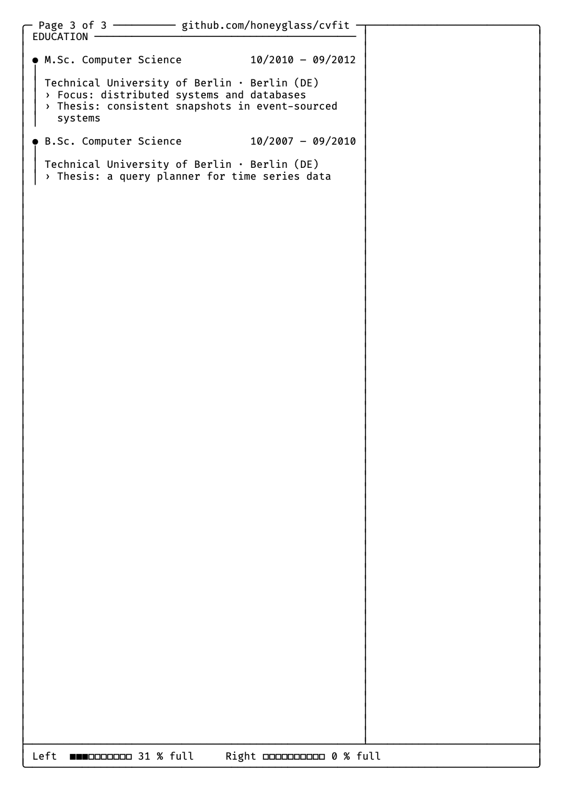

## 📋 Lukas Berger · DaVita

The agent put the cloud and infrastructure skills first, moved the languages to page 1 and hid
the interests. The certificates the posting names as a plus stand at the top of page 2.

| [Posting](../examples/showcase/davita-it-project-manager/posting.md) | [Agent's report](../examples/showcase/davita-it-project-manager/report.md) | [Preview](../examples/showcase/davita-it-project-manager/preview.txt) |
| :--- | :--- | :--- |
| **Classic** | [Word](../examples/showcase/davita-it-project-manager/davita-it-project-manager.docx) | [PDF](../examples/showcase/davita-it-project-manager/davita-it-project-manager.pdf) |
| **Terminal** | [Word](../examples/showcase/davita-it-project-manager/davita-it-project-manager-terminal.docx) | [PDF](../examples/showcase/davita-it-project-manager/davita-it-project-manager-terminal.pdf) |

  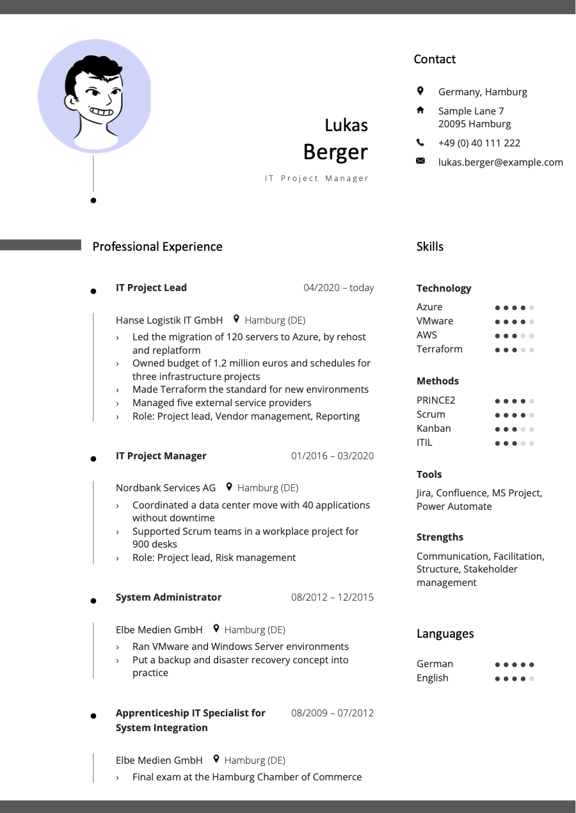
  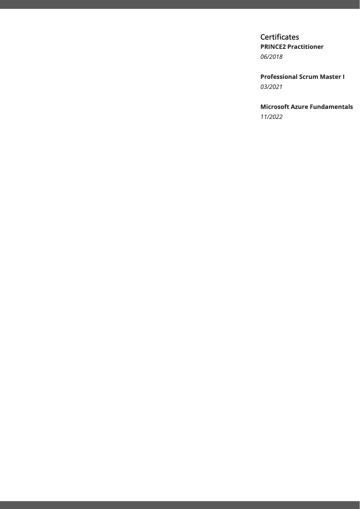

  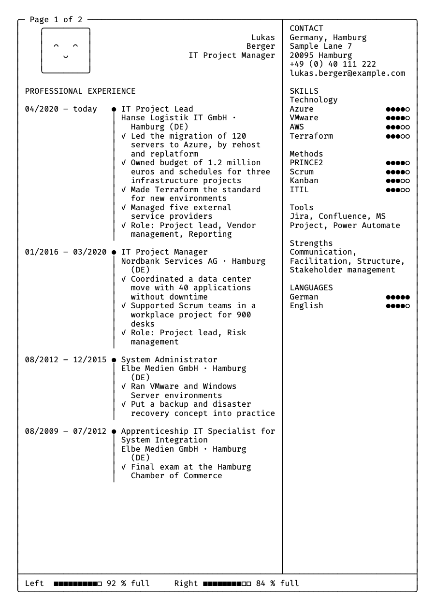
  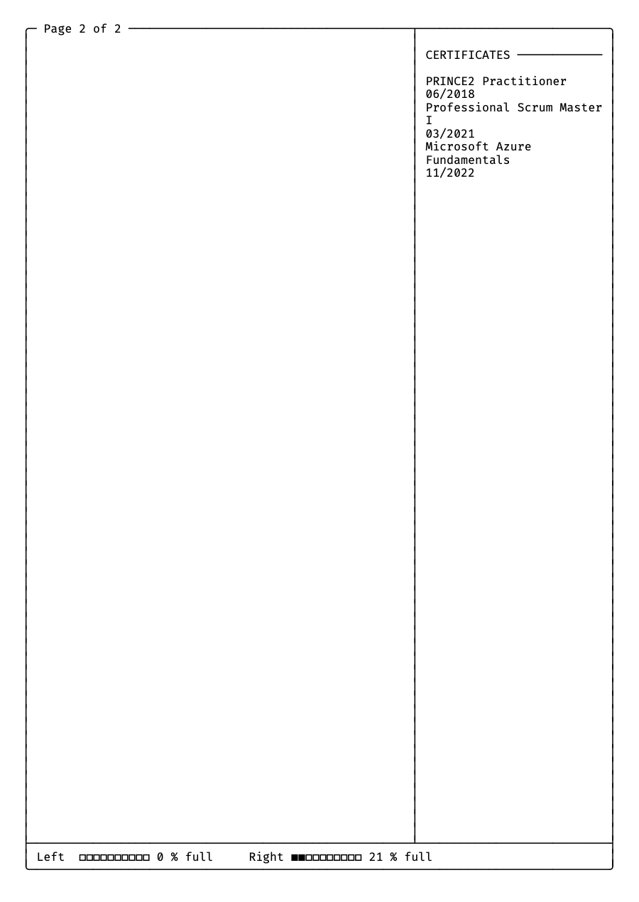

## 🍳 Marco Weber · GALERIA

The agent fitted the CV to one page: strengths first, as the posting asks for reliability and
teamwork, languages moved to page 1, and the interests hidden.

| [Posting](../examples/showcase/galeria-cook/posting.md) | [Agent's report](../examples/showcase/galeria-cook/report.md) | [Preview](../examples/showcase/galeria-cook/preview.txt) |
| :--- | :--- | :--- |
| **Classic** | [Word](../examples/showcase/galeria-cook/galeria-cook.docx) | [PDF](../examples/showcase/galeria-cook/galeria-cook.pdf) |
| **Terminal** | [Word](../examples/showcase/galeria-cook/galeria-cook-terminal.docx) | [PDF](../examples/showcase/galeria-cook/galeria-cook-terminal.pdf) |

  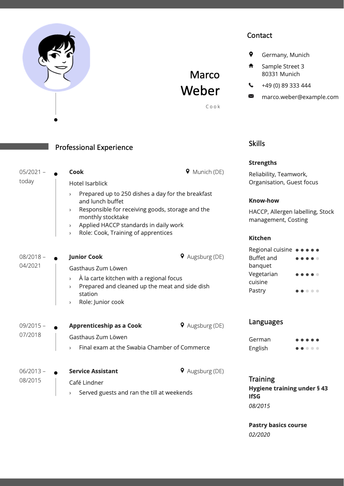
  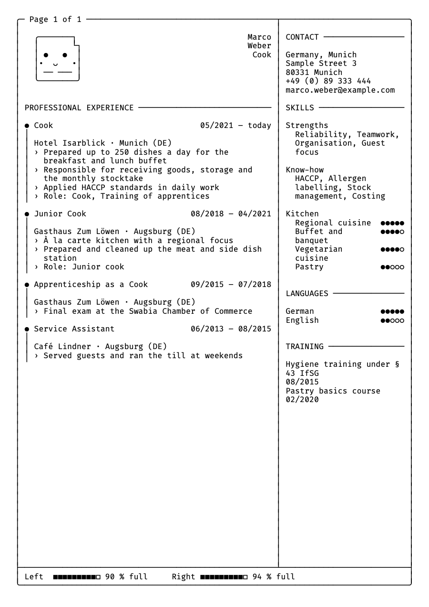

---

[← Back to the README](../README.md)
